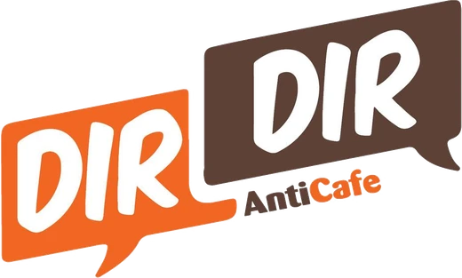

<p align="center">
  
</p>

<h1 align="center">DırDır Anticafe</h1>

<p align="center">
  Bakıda anticafe — vaxta görə ödə, oyna, film izlə, dostlarla vaxt keçir.<br>
  <a href="https://www.dirdir.az"><b>www.dirdir.az</b></a> ·
  <a href="https://www.instagram.com/dirdiranticafe/">Instagram</a>
</p>

---

## 🌐 Canlı sayt

Sayt artıq canlıdır və öz domenində yerləşir: **[dirdir.az](https://www.dirdir.az)**

## Sayt haqqında

DırDır Anticafe-nin rəsmi saytı. Sayt üç dildə (Azərbaycan, İngilis, Rus) işləyir, açıq və qaranlıq rejimi var, telefonda rahat açılır.

**Ziyarətçilər üçün**

- Qiymətlər və **qiymət hesablayıcısı** — ümumi zal və kino otağı, tələbə endirimi, promokod
- Oyunlar səhifəsi — hər oyunun necə oynanıldığı
- **Arena** — komanda yarışları, həftəlik / aylıq / ümumi xal lövhəsi
- Hədiyyə çarxı, tədbirlər, menyu
- Qeydiyyat və giriş (email və ya telefon), şəxsi kabinet
- Kino otağını WhatsApp ilə rezerv etmək
- Rəy və təklif forması

**İdarəetmə paneli**

- Yarışlar, komandalar, xallar və hədiyyələr
- Slayder, oyunlar, qiymətlər, promokodlar
- İstifadəçilər (axtarış, filtrlər, bloklama)
- Gələn rəylər və xəbər göndərişləri

## Texnologiyalar

| Hissə | Texnologiya |
|---|---|
| Frontend | React 18, Vite, Tailwind CSS, React Router |
| Backend | Node.js 20+, Express 5, Prisma |
| Baza | PostgreSQL |
| Hostinq | Vercel (sayt), Render (API), Neon (baza) |

## Lokal işə salmaq

```bash
npm install
npm run dev
```

Sayt `http://localhost:5173` ünvanında açılır. Backend olmadan da işləyir — bu halda demo rejimdədir (formalar yalnız yoxlanır, Arena nümunə lövhə göstərir).

Backend-i qoşmaq üçün: [server/README.md](server/README.md).

Production build:

```bash
npm run build
npm run preview
```

## Struktur

```
src/
  components/   saytın bölmələri (Hero, Pricing, Calculator, PrizeWheel, ...)
  pages/        səhifələr (Home, Games, Arena, Account, Login, ...)
  pages/admin/  idarəetmə paneli
  i18n/         mətnlər — az.js, en.js, ru.js
  data/         biznes məlumatları (ünvan, iş saatları, standart qiymətlər)
  lib/          API, SEO və köməkçi funksiyalar
server/         API (Express + Prisma) — ətraflı: server/README.md
public/         loqo, favicon, sosial önizləmə şəkli
```

## Rəng palitrası

| Rəng | Kod |
|---|---|
| Çəhrayı | `#FF4F81` |
| Bənövşəyi | `#7C5CFF` |
| Sarı | `#FFC839` |
| Firuzəyi | `#00BFA6` |
| Fon | `#F5FBF6` |

Rənglər `tailwind.config.js` faylındadır.

---

<p align="center">© DırDır Anticafe · Bakı</p>
